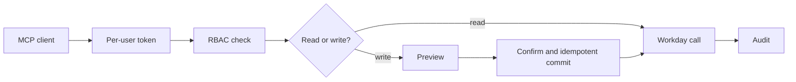

# workday-mcp-schema

A permission-safe Workday MCP server baseline in Node.js and TypeScript: task-shaped tools, per-user OAuth, preview-then-confirm writes and audited calls.

<!-- Demo slot: a demo goes here, directly under the tagline, once real footage exists. -->

## About

workday-mcp-schema is a reusable baseline for custom Workday MCP servers. It is for teams building their own Workday agent tooling. It is layer 3 of the Workday agent stack: prefer native Agent-Ready MCP tools first, then Custom Agent Actions (Orchestrate), and use this baseline for cross-tenant patterns, guardrails or multi-system composition.

- Task-shaped tools with Zod contracts, listed in one registry. There is no raw passthrough tool and no payroll write.
- Per-user OAuth 2.0 (authorization code with PKCE). No shared account and no service-account fallback.
- RBAC before every Workday call, mapped to Workday security groups.
- Preview-then-confirm writes, idempotent commits, and an audit log with PII redaction.
- A local catalog of native Agent-Ready tools, plus optional Slack and Notion integrations.

Related: [Internal People Agent](https://github.com/peopletechflow/internal-people-agent) and [Performance Review Cycle Helper](https://github.com/peopletechflow/performance-review-cycle-helper) adapt their security patterns from this repository.

## Main Logic



- **Contracts.** Tool inputs, outputs and API objects are Zod schemas in [`src/schemas/`](src/schemas/). Every tool is listed in [`src/tools/registry.ts`](src/tools/registry.ts), and startup fails on drift. See [docs/SCHEMA.md](docs/SCHEMA.md).
- **Workday client.** Fixtures are the default (`WORKDAY_USE_FIXTURES=true`). With fixtures off, the HTTP client returns a `NOT_IMPLEMENTED` error for fixture-only tools, with no silent fallback.
- **Writes.** `commit_*` needs a valid `previewToken`, `userConfirmed: true` and an `idempotencyKey`. Retries return the stored result. Submits go through the Workday business process.
- **Agent-Ready catalog.** `src/agent-ready/` documents native Agent-Ready tools for local discovery. It does not re-implement Workday MCP. Native self-service writes run only through the preview and confirm guard.
- **Model calls.** All go through `src/ai/` (Vercel AI SDK). Leave `AI_GATEWAY_API_KEY` unset or set `WORKDAY_AI_DISABLED=1` in CI and fixtures.

Layers, catalog and tool reference: [docs/ARCHITECTURE.md](docs/ARCHITECTURE.md).

### Security

- **Per-user access.** Every call uses the caller's own access token, stored encrypted per user.
- **RBAC.** Roles `worker_self`, `manager`, `hr_partner`, `payroll_viewer` and `admin` map to Workday security groups and the ASOR skill's Available To list. Per-user `tool:<name>` grants and denies add least privilege. See [docs/RBAC.md](docs/RBAC.md).
- **Gated live operations.** Production tenants stay blocked unless `WORKDAY_ALLOW_PROD=true`. Live Workday operations stay blocked until validated in your sandbox: [docs/SANDBOX-TESTING.md](docs/SANDBOX-TESTING.md).
- **Kill switch.** `WORKDAY_DISABLED_TOOLS` turns off listed tools.

Report vulnerabilities privately: [SECURITY.md](SECURITY.md). MCP authorization notes: [docs/MCP-AUTHORIZATION.md](docs/MCP-AUTHORIZATION.md).

## Deployment and Install

**Prerequisites:** Node.js 18 or later and pnpm 10. Live use needs a Workday sandbox or implementation tenant and an OAuth API client.

**Configure:** copy `.env.example` to `.env` and fill in the placeholders: `WORKDAY_BASE_URL`, `WORKDAY_TENANT`, `WORKDAY_OAUTH_CLIENT_ID`, `WORKDAY_OAUTH_CLIENT_SECRET`, `WORKDAY_OAUTH_REDIRECT_URI`, `WORKDAY_USE_FIXTURES` and `WORKDAY_USER_ROLES` (dev only). Develop against a sandbox or implementation tenant only.

**Run the stdio MCP server:**

```bash
pnpm install
pnpm check         # typecheck, rbac, mcp, integrations, migrations and durable runtime checks (offline)
pnpm build
pnpm start         # or: pnpm dev
```

An example MCP client config is in [docs/ARCHITECTURE.md](docs/ARCHITECTURE.md#example-mcp-client-config-stdio).

**HTTP runtime** (Slack intake, approvals, OAuth account linking, Postgres state): `pnpm build && pnpm db:migrate && pnpm serve`. Integrations are off by default. See [docs/RUNBOOK.md](docs/RUNBOOK.md), [docs/DATABASE.md](docs/DATABASE.md) and [docs/INTEGRATIONS.md](docs/INTEGRATIONS.md). A `Dockerfile` is included.

**Workday native skills:** [extend/](extend/README.md) mirrors the Workday Extend app that hosts the custom agent skills. It is documentation; the source of truth lives in the tenant. Refresh the Agent-Ready catalog with `pnpm sync:agent-ready --csv <Explorer.csv>` (see `src/agent-ready/sync.md`).

**CI:** no workflow is installed. Run `pnpm check` locally.

More: [HANDOVER](HANDOVER.md), [CHANGELOG](CHANGELOG.md), [AGENTS](AGENTS.md). Contributing: see [CONTRIBUTING.md](CONTRIBUTING.md).

## License

MIT. See [LICENSE](LICENSE).

This software is provided as is, without warranty of any kind. The maintainers and PeopleTech Flow B.V. accept no responsibility or liability for any use, data, HR decisions or outcomes. You are responsible for your own tenant, security and compliance, including your Workday agreements and applicable law.

Independent project, not affiliated with or endorsed by Workday, Inc. Workday is a trademark of Workday, Inc. Built for sandbox and implementation tenants, with fixture mode as the default. Not yet run against a production tenant. Fixture data is invented.
