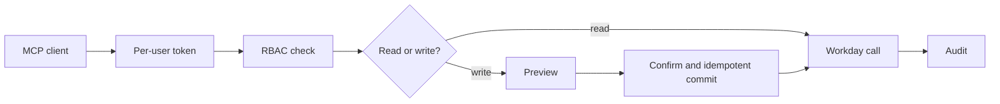

# workday-mcp-schema

A TypeScript MCP server baseline for Workday, from PeopleTech Flow B.V. in Utrecht. It exposes task-shaped tools, per-user OAuth, and preview-then-confirm writes. Fixture mode is the default (`WORKDAY_USE_FIXTURES=true`), with invented people. The Agent-Ready tool catalog (152 of 158 tools, the tenant-discovered rows in `src/agent-ready/catalog.tenant.ts`) and the Extend skills were discovered on the Workday developer tenant `bzyvydgxsb_extdev` (wd119) on 2026-10-20 via the Workday Developer Agent. This runtime server has not been validated live, has not been run against a production tenant, and is not certified for production. Live Workday behavior depends on the customer's tenant, and the tests in this repository do not verify that tenant.

## What it is

Use native Workday Agent-Ready tools first, then a Custom Agent Action in Workday Extend when the process is specific to one tenant, and a tool in this repository when you need a pattern you can reuse: a Zod contract, per-user OAuth, role checks, a preview, a human confirm, and an audit record. This repository is that third layer. `extend/` documents skills that live in a dev tenant. It is not the server.

Details: [docs/ARCHITECTURE.md](docs/ARCHITECTURE.md).

## What it does not do

There is no raw Workday passthrough tool and no payroll write. There is no shared integration account. Account linking does not prove which worker signed in. The people in the fixtures are invented. This project is not a Workday product, and it does not re-implement Workday's Agent-Ready MCP server.

## How it works



Two runtimes:

- **stdio MCP** (`src/index.ts`). Credentials, the user id, and roles come from the environment. The per-user Workday sign-in is a separate OAuth flow. See [docs/MCP-AUTHORIZATION.md](docs/MCP-AUTHORIZATION.md).
- **HTTP runtime** (`pnpm serve`). Slack webhooks, account linking, and approvals. It is not an MCP endpoint. Callers are a verified Slack signature plus an active identity link.

Model calls go through `src/ai/`. They stay off when `AI_GATEWAY_API_KEY` is unset.

Reads check permission, call Workday with the caller's token, and append an audit line. Writes store the exact payload, wait for a human, then commit through code with an idempotency key. A timeout, HTTP 5xx, or network error is stored as unknown and is not submitted again until it is reconciled. The integration agent can propose a change. It cannot approve or commit.

## Tools

The server exposes 13 outcome-shaped tools, one per goal, instead of one tool per Workday operation. `time_off` covers balances, history, request, cancel, and manager approve or deny. Each write is an action (`request_preview`, then `request_commit`) with the same preview token, confirmation, idempotency key, and RBAC as before. `worker`, `organization`, `benefits`, and `pay` run the reads this server implements. `job`, `compensation`, `talent`, `recruiting`, `personal_data`, `expenses`, and `business_process` look up catalog operations for that goal and do not call Workday. `catalog` searches the whole catalog. The 158 tenant and seed operations stay in `src/agent-ready/` and are routed internally. They are not deleted.

Set `WORKDAY_EXPOSE_FULL_CATALOG=true` to also register one discovery tool per catalog operation. That flag is off by default. Those extra tools return catalog metadata only. They do not call Workday, and payroll writes stay unavailable.

Token counts use `gpt-tokenizer` (cl100k_base) on the JSON `tools/list` payload:

| Surface                                  | Tools | Tokens |
| ---------------------------------------- | ----- | ------ |
| Previous hand-written MCP tools          | 18    | 17,287 |
| Outcome tools (default)                  | 13    | 3,999  |
| Outcome tools plus the full catalog flag | 171   | 33,035 |

The cut follows the same idea as Amplitude's MCP cleanup: loading a large tool list spends the context window before the model does any work. Descriptions stay short. Each tool takes an `action` enum, and the handler still checks the stricter per-action schema.

Permission ids for the old operation names still apply. `tool:get_my_time_off_balance` denies the `balances` action. `WORKDAY_DISABLED_TOOLS` accepts either the outcome name or the operation name.

## How to run

**Prerequisites:** Node.js 22 or newer (`engines` is `>=22`; CI and the Docker image use Node.js 22) and pnpm 10. A live tenant needs a Workday sandbox or implementation tenant and an OAuth API client.

**Configure:** copy `.env.example` to `.env`. Develop against a sandbox or implementation tenant only.

```bash
pnpm install
pnpm check         # typecheck, lint, format, audit, rbac, mcp, safety, integrations, migrations, and a PGlite durable run
pnpm build
pnpm dev           # stdio MCP server (or: pnpm start after build)
```

An example MCP client config is in [docs/ARCHITECTURE.md](docs/ARCHITECTURE.md#example-mcp-client-config-stdio).

**HTTP runtime** (Slack intake, approvals, OAuth account linking, Postgres): `pnpm build && pnpm db:migrate && pnpm serve`. Integrations are off by default. See [docs/RUNBOOK.md](docs/RUNBOOK.md), [docs/DATABASE.md](docs/DATABASE.md), and [docs/INTEGRATIONS.md](docs/INTEGRATIONS.md). A `Dockerfile` is included.

GitHub Actions runs `pnpm check` on pull requests.

**Workday native skills:** [extend/](extend/README.md) mirrors skills that live in the tenant. Refresh the local catalog with `pnpm sync:agent-ready --csv <Explorer.csv>` (see `src/agent-ready/sync.md`).

More: [HANDOVER](HANDOVER.md), [CHANGELOG](CHANGELOG.md), [AGENTS](AGENTS.md). Contributing: [CONTRIBUTING.md](CONTRIBUTING.md).

## Security model

- **Per-user OAuth.** Authorization code with PKCE. The refresh token is encrypted for that user. The stdio file store binds the ciphertext to the user id (`token:<userId>`). A `tokens.json` written before that binding does not decrypt. Sign in again. The Postgres store binds ciphertext to tenant and user.
- **Roles on stdio.** `WORKDAY_USER_ROLES` for the life of the process, default `worker_self`. This server does not look up Workday security groups. Live calls still use the caller's token, and Workday enforces that token.
- **HTTP callers.** Slack request signature plus an active `identity_links` row. Identity is not taken from the message body or from model output.
- **RBAC.** Deny overrides grant. The check runs before any Workday call. Workday security on the token is the final authority for live data.
- **Writes.** The proposal stores the payload. A human approves with a verified identity. Commit goes through `ApprovalExecutionService` and the ledger. There is no agent tool that approves.
- **Live operations.** Blocked until listed in `WORKDAY_VALIDATED_OPERATIONS` after you validate them in your sandbox. See [docs/SANDBOX-TESTING.md](docs/SANDBOX-TESTING.md).
- **Production hosts.** Refused unless `WORKDAY_ALLOW_PROD=true`.
- **OAuth scopes.** The default `openid` in `.env.example` is unverified against a Workday tenant. Set the scopes your API client actually grants after you confirm them. This repository does not validate that list.
- **Untrusted content.** Tool results and Workday fault text are data for any model that reads them. The agents in `src/ai/` wrap tool results and tell the model that text inside the wrapper is not instructions. Fault messages are scrubbed for bearer tokens and email addresses before they are returned.
- **Audit redaction.** Field names are matched after normalization, including `preferredName`, `descriptor`, pay amounts, and national-id, bank, and passport patterns. Email addresses and bearer tokens inside other strings are scrubbed. A name sitting in a free-text field whose name is not itself sensitive can remain. `comment` and `reason` are removed entirely.
- **Kill switch.** `WORKDAY_DISABLED_TOOLS` turns off listed tools.

Report vulnerabilities privately: [SECURITY.md](SECURITY.md).

## Limits

- No live run of `HttpWorkdayClient` is recorded, and no signed-off request/response contract is recorded. `WORKDAY_VALIDATED_OPERATIONS` is empty by default, pending sign-off against a sandbox tenant, so live absence operations stay refused. Body and filter field names still need confirmation against the tenant REST directory.
- Account linking does not verify that the Workday account which signs in is the invited user. Production requires `LINK_ACCEPT_UNVERIFIED_SIGNER=true` as an explicit acknowledgement. Calls use the `me` entry on the stored token.
- Only self-service time off is wired through the Slack approval path.
- The Extend skills and the Agent-Ready tool catalog (152 of 158 tools, the tenant-discovered rows in `src/agent-ready/catalog.tenant.ts`) were discovered on the Workday developer tenant `bzyvydgxsb_extdev` (wd119) on 2026-10-20 via the Workday Developer Agent (see `extend/README.md`). This runtime server has not been validated live and is not certified for production.
- Stdio roles are the environment variable above. They are not derived from the token.

## Layout

| Task                         | Start at                                                            |
| ---------------------------- | ------------------------------------------------------------------- |
| Tool contract or schema      | `src/schemas/tools/*.ts`, then `src/tools/registry.ts`              |
| RBAC or a permission id      | `src/rbac/permissions.ts`, [docs/RBAC.md](docs/RBAC.md)             |
| Slack command, form, button  | `src/integrations/slack/*.ts`                                       |
| Approval lifecycle or ledger | `src/integrations/approvals/execution.ts`, `src/store/approvals.ts` |
| OAuth, tokens, linking       | `src/auth/*.ts`, `src/integrations/link.ts`, `src/store/repos.ts`   |
| Agent prompt or toolset      | `src/ai/integration-agent.ts`, `src/ai/enterprise-agent.ts`         |
| Checks                       | `scripts/check-*.ts`                                                |

## License

MIT. See [LICENSE](LICENSE).

This software is provided as is, without warranty of any kind. The maintainers and PeopleTech Flow B.V. accept no responsibility or liability for any use, data, HR decisions or outcomes. You are responsible for your own tenant, security and compliance, including your Workday agreements and applicable law.

Independent project, not affiliated with or endorsed by Workday, Inc. Workday is a trademark of Workday, Inc. Built for sandbox and implementation tenants, with fixture mode as the default (`WORKDAY_USE_FIXTURES=true`) and invented fixture people. The Agent-Ready catalog and Extend skills were discovered on developer tenant `bzyvydgxsb_extdev` (wd119) on 2026-10-20. This runtime server has not been validated live, has not been run against a production tenant, and is not certified for production.
